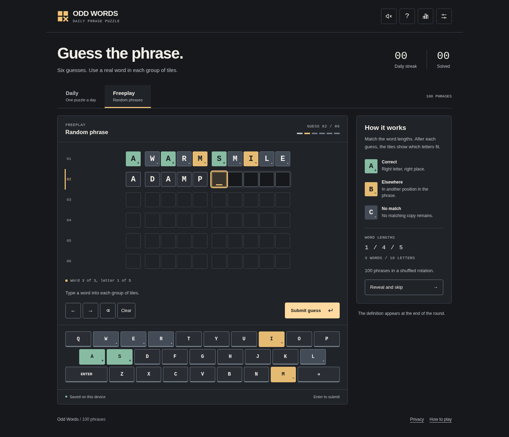
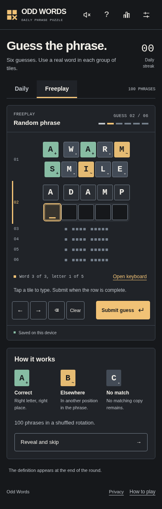

# Odd Words

A daily phrase puzzle with six guesses and unlimited freeplay. Built with
plain JavaScript, CSS and Node's built-in tools. No runtime packages, accounts,
API keys, database, or external dictionary service are required.



## Run locally

Use Node.js **22.12 or newer**. The included `.nvmrc` selects Node 24.

```sh
npm ci
npm run verify
npm run dev -- --open
```

Open `http://localhost:5173`. Refresh after editing files; this development
server does not include hot reload. Stop it with Ctrl+C. On Windows PowerShell,
use `npm.cmd` in place of `npm` if script execution is restricted. See
[START-HERE-WINDOWS.md](START-HERE-WINDOWS.md).

## Updating your existing repository

This is the updated version of the uploaded **Odd Words** project, not a new
framework or replacement prototype. Back up your work, then copy the extracted
project files into your existing Odd Words repository. Keep its `.git` folder
and remote configuration. This archive intentionally contains no Git history,
credentials, `node_modules`, or external font files.

The save format and key, `odd-words:v1`, are unchanged. Existing valid saves
continue working when the updated site uses the same domain and browser.
The 100 phrases, their meanings, daily schedule and dictionary are preserved.

## What changed in 1.1.0

- **Mobile input:** the game keyboard is hidden on narrow screens and primary
  touch devices, including landscape. Tap a tile or **Open keyboard** to use
  your device keyboard. A strong outline, underline, highlighted word and
  word/letter position label identify the active cell. Future rows are compact;
  the board scrolls to the selected tile without shrinking every word.
- **Presentation:** plain copy, charcoal surfaces, warm white text, muted gold
  controls, and readable green/amber/gray feedback. Feedback symbols are on by
  default. System reduced-motion preferences remain supported.
- **Privacy:** a standalone, readable-without-JavaScript privacy notice,
  linked from the footer and Settings. It distinguishes local saves from
  Vercel hosting records. Clear saved data removes only this game's key and
  resets other open game tabs when they receive the deletion event.
- **Sound:** quiet synthesized cues for typing, deleting, submission, invalid
  guesses, wins and losses. Sound is off by default; the header and Settings
  offer an explicit toggle. No audio files or microphone permission are used.



## Before publishing the privacy notice

Edit **`src/site-config.js`** with your public operator name and privacy contact
email, then rebuild. The build inserts these details into the static notice,
so they also work without JavaScript. Do not put credentials in this file.

Review your Vercel project's analytics, Speed Insights, security, deployment
protection and log-export settings. They cannot be established from the
repository. The supplied app contains no analytics integration, but Vercel
still processes hosting requests. Retention depends on the service and actual
configuration; no fixed retention period is invented in the notice.

See [docs/PRIVACY.md](docs/PRIVACY.md) for the source references and publishing
checklist. The build warns when operator details are missing; it does not
prevent local development.

## Vercel deployment

The included `vercel.json` uses:

| Setting | Value |
| --- | --- |
| Framework preset | Other / no framework |
| Build command | `npm run build` |
| Output directory | `dist` |
| Install command | `npm ci` or the detected default |

Keep the existing Git integration and push the updated source. The build copies
`index.html`, `privacy.html`, `src/`, `public/`, and license notices into `dist/`.
That includes **`public/dictionary/english.txt`**, all 100 phrases, the daily
schedule, native-input code and local sound code. No server functions or
environment variables are needed. Do not deploy only `index.html`.

To inspect the exact production files locally:

```sh
npm run build
npm run preview -- --open
```

The preview is at `http://localhost:4173` and has its own local save, separate
from port 5173 and your production domain. The ZIP includes a rebuilt `dist/`
for convenience; `.gitignore` keeps generated output out of Git. Vercel rebuilds
it from source. Relative asset paths continue to support repository-subpath
hosting. Optional GitHub Pages workflows are retained.

## Game rules

Every submitted word must match its tile count and appear in the local word
list. The whole guess does not have to form a meaningful expression. Incomplete
or unknown-word guesses do not spend an attempt.

Green / **+** means the correct letter and position. Amber / **~** means the
letter occurs elsewhere in the phrase, including another word. Gray / **-**
means no matching copy remains. Exact matches are assigned before other
matches, so repeated letters are counted correctly.

Daily puzzles reset at **00:00 UTC** using the unchanged schedule, which starts
on 2026-10-27 and repeats every 100 days. Freeplay uses a shuffled bag and keeps
its progress separate from Daily. Revealing/skipping a freeplay round does not
count as a loss. The definition and a reference link appear at the end.

Desktop supports physical and on-screen keyboards. On a phone, use the native
keyboard. Enter submits, Backspace deletes, arrows move, and Space advances to
the next word. Select a tile to replace its letter. Paste a whole phrase with
matching word lengths. The latest 1,000 completed results are stored locally.

## Commands

| Command | Purpose |
| --- | --- |
| `npm run dev -- --open` | Start development server and open browser |
| `npm run dev -- --port 5174` | Use another port |
| `npm run check` | Validate syntax, imports, content and dictionary |
| `npm test` | Run the built-in Node test suite |
| `npm run test:watch` | Re-run Node tests on changes |
| `npm run dictionary` | Rebuild dictionary from bundled source |
| `npm run build` | Validate and produce static `dist/` |
| `npm run verify` | Run checks, tests and build |
| `npm run preview -- --open` | Preview `dist/` at port 4173 |

`npm ci` has no third-party npm packages to download. Optional browser QA has
separate Python/Playwright requirements and is **not** needed to run, build,
verify with Node, or deploy the game.

## Project structure

```text
index.html                    Game page
privacy.html                  Privacy notice
src/main.js                   Game controller and UI
src/styles.css                Responsive styles and colour tokens
src/site-config.js            Public operator/contact details
src/privacy.js                Privacy-page controls
src/lib/native-input.js       Mobile input and composition handling
src/lib/effects.js            Local audio and victory particles
src/lib/game.js                Pure game rules
src/lib/storage.js             Saves, deletion and statistics
src/data/phrases.json          100 phrases and meanings
src/data/daily-schedule.json   Fixed daily rotation
public/dictionary/english.txt Bundled 112,795-word dictionary
scripts/                      Local server, validation and build
tests/                        Node tests
qa/                           Optional browser regression harness
docs/                         Setup, privacy and verification notes
vercel.json                   Static deployment and response headers
```

## Verification and limits

The delivered revision passes **137 Node tests**, **75 Chromium interaction
checks**, and **all 100 phrases at both 320px and 393px widths** without
horizontal overflow. Colour token combinations have automated contrast checks.
See [docs/VERIFICATION.md](docs/VERIFICATION.md) for exact coverage and limits.

Chromium UI checks used the real application files through a local-file
transport harness with an in-memory storage adapter because this environment
blocks browser navigation. HTTP serving was tested separately with real Node
requests. Native phone keyboards on physical iOS/Android devices, screen-reader
behavior, actual Vercel settings and a live deployment still require checking.
This is not a full accessibility or legal-compliance certification.

Answers are intentionally public client-side data. There is no anti-cheat
system, cloud save, account synchronization, service worker, or general
cross-tab save-conflict resolution. The game follows the device clock.

## License

Original code and visuals: [MIT](LICENSE). Dictionary sources retain their own
notices: [THIRD_PARTY_NOTICES.md](THIRD_PARTY_NOTICES.md) and
[licenses/SCOWL.txt](licenses/SCOWL.txt).
